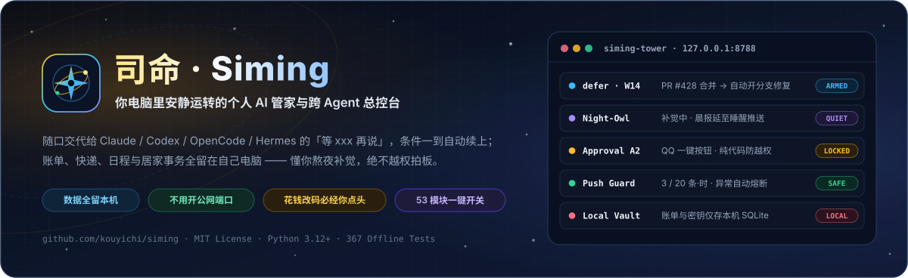
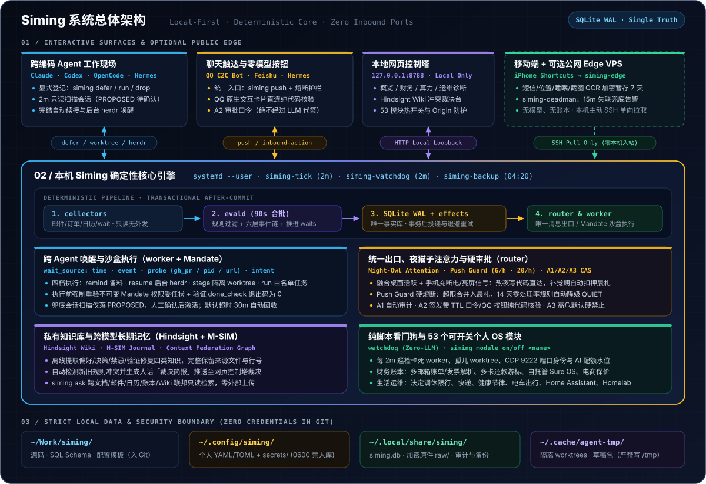
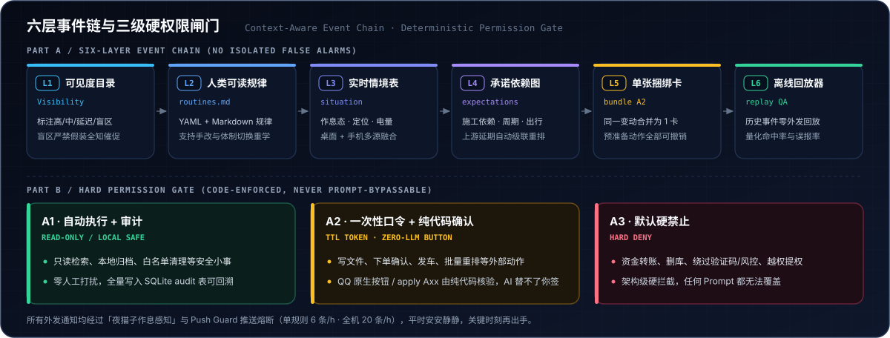

<div align="center">



<p>
  <a href="https://www.python.org/"></a>
  <a href="docs/ARCHITECTURE.md"></a>
  <a href="docs/MODULES.md"></a>
  <a href="#运行测试"></a>
  <a href="LICENSE"></a>
</p>

<p>
  <a href="#你为什么需要司命"><b>为什么用司命</b></a> ·
  <a href="#使用体验承诺"><b>核心体验</b></a> ·
  <a href="#日常怎么用4-个高频场景"><b>高频场景</b></a> ·
  <a href="#系统架构"><b>系统架构</b></a> ·
  <a href="#5-分钟跑起来"><b>5 分钟上手</b></a> ·
  <a href="docs/SETUP_GUIDE.md"><b>完整配置教程</b></a>
</p>

</div>

---

## 你为什么需要司命？

如果你同时用着 **Claude Code / Codex / OpenCode / Antigravity / Hermes** 写代码，又被多张信用卡账单、报销发票、网购保价、快递取件、法定调休和居家琐事包围，大概都遇到过这些时刻：

| 没有司命之前 | 用上司命之后 |
| :--- | :--- |
| 在某个 Agent 对话里随口说「等这个 PR 合并后删掉兼容代码」，切去忙别的，三天后彻底忘掉 | **随口交代即托管**：关掉窗口就放心忙别的，PR 一合并它自动提醒、后台拉起原对话，或在独立分支改好跑完测试把 diff 递到你面前 |
| 凌晨三点写代码时急事漏看；难得上午补个觉，08:15 就被一堆机器人晨报吵醒 | **懂你熬夜，也护你补觉**：凌晨干活重要消息秒达；补觉期间晨报和普通提醒自动压到你自然醒，异常刷屏自动熔断 |
| 想让 AI 帮你多干点活，但一想到它可能误改文件、乱下单、自己替你点确认就不敢放手 | **小事静默办，大事等你点**：查资料和归档自动搞定；涉及改文件、消费或重排日程只发一张 QQ 按钮确认卡，AI 永远替不了你拍板 |
| 账单、邮件、笔记、对话散在十几个地方；用云端 AI 管家又不敢把银行账单和密钥交出去 | **全留自己电脑，不用开公网端口**：数据库和密钥全在本机硬盘，53 个能力用什么开什么，不需要的一行命令关掉 |

---

## 使用体验承诺

我们不拿一堆框架术语轰炸你 —— 装上司命后，你真切能感受到的是这 **5 件事**：

1. **随口说一句「等 xxx 再说」，以后真不用自己惦记了**
   不管是等时间（自动算中国法定调休）、等 PR 合并 / 进程结束 / 网页恢复、等账单入库或快递签收，还是等下次聊天再提到「报销」时提醒你，司命都会帮你盯着，条件一到立刻连同上下文一起接上。
2. **平时安安静静，只在真正需要你的时候出手**
   它会结合你电脑键鼠活跃度和手机充断电/亮屏信号感知你是在熬夜干活还是在补觉；如果某条提醒你连续两周从不点开，它会自动闭嘴退回每日晨札，绝不拿无用推送烦你。
3. **真要花钱或动你的文件，永远等你亲自点头**
   查账、归档、检索这类安全小事静默办完并记好账；一旦碰到改代码、下单确认、重排预约等动作，只会给你发一张整合好的确认卡（QQ 点一下按钮就行）。按钮校验 100% 由纯代码完成，任何 AI Agent 都绕不过去，更不可能私自转账或删库。
4. **你的隐私、账单和密钥，永远只待在自己电脑里**
   所有记账明细、聊天记录、本地笔记和凭据（`0600` 权限）全存在本机 SQLite 里，不上传任何第三方云服务；即使接上 iPhone 快捷指令转发短信或位置，也是由本机主动去拉取，家用电脑无需向公网暴露任何端口。
5. **5 分钟就能用起来，不需要的功能随时一键关掉**
   不需要一次性配齐所有东西。纯本机最小模式只需 5 分钟；财务 OS、电车、智能家居、Homelab、日常照护等 **53 个垂直模块**全部独立开关，不用的直接 `siming module off <模块名>`，清爽干净且保留历史数据。

---

## 日常怎么用？4 个高频场景

<table>
  <tr>
    <td width="50%" valign="top">
      <h3>1. 跨 Agent 挂起与自动收尾</h3>
      <p>写代码时随手托管一个条件，条件一满足自动在独立 <code>git worktree</code> 改完并跑通测试，把干净 diff 发给你确认。</p>
<pre><code class="language-bash"># 等 PR #428 合并后，自动清理临时开关并跑单测
siming defer add \
  --when "probe:gh_pr_merged:owner/repo#428" \
  --mode stage \
  --cwd ~/Work/my-app \
  --done-check "pytest -q" \
  --quote "删除旧版 feature flag 并跑通测试"</code></pre>
    </td>
    <td width="50%" valign="top">
      <h3>2. 长任务托管 + 完工通知</h3>
      <p>跑训练、构建、压测不用一直切终端盯进度，套一层 <code>siming run</code>，结束时自动带耗时和退出码通知你。</p>
<pre><code class="language-bash"># 包装任何长命令，跑完或失败立刻推送回执
siming run --name "全量回归测试" -- pixi run pytest -q

# 每天一眼看清今日待办、调休、账单与快递
siming today</code></pre>
    </td>
  </tr>
  <tr>
    <td width="50%" valign="top">
      <h3>3. 全机私有知识库秒级检索</h3>
      <p>把你的 Obsidian 笔记、历史决策、邮件账单和过往踩坑经验打通，一行命令带<strong>文件:行号</strong>出处直接答复。</p>
<pre><code class="language-bash"># 跨文档、账本、Hindsight Wiki 联邦只读检索
siming ask "上个月报销还差哪几张发票？"

# 打开本地网页控制塔（仅 127.0.0.1 可访问）
siming tower serve --host 127.0.0.1 --port 8788</code></pre>
    </td>
    <td width="50%" valign="top">
      <h3>4. 按需开关 53 个生活与运维模块</h3>
      <p>只留下你真正需要的能力，控制塔网页或命令行都能随时热开关，零负担演进你的个人 OS。</p>
<pre><code class="language-bash"># 查看所有模块状态
siming module ls

# 不开电车 / 不做装修？一行关掉即可
siming module off ev_trip_advisor
siming module off renovation_tracker</code></pre>
    </td>
  </tr>
</table>

---

## 系统架构

<div align="center">
  
</div>

> **一眼看懂核心边界**：外部手机信号可选经过一台极简 VPS 加密暂存，由本机主动 SSH 单向拉取（**本机零公网入站端口**）；本机内部严格区分「只读采集 `collectors` → 规则与事件链 `evald` → SQLite WAL 事务与 `effects` → 唯一出口 `router` & 沙盒 `worker`」，杜绝模型直连外部写操作。
>
> 想了解进程隔离、表结构与完整时序图？见 **[docs/ARCHITECTURE.md](docs/ARCHITECTURE.md)**。

---

## 为什么很少误报、也绝不越权？

孤立的提醒脚本很容易「乱报」或「乱做」。司命把每一次触发都收进**六层上下文事件链**，并由**三级硬权限闸门**兜底：

<div align="center">
  
</div>

---

## 5 分钟跑起来

> 推荐先用 **Tier 1 纯本机模式**体验核心功能，再按 **[docs/SETUP_GUIDE.md](docs/SETUP_GUIDE.md)** 的 6 个阶段逐步接入 QQ/飞书按钮、systemd 常驻、网页控制塔、iPhone 快捷指令和财务账本。

### 第 1 步：克隆并安装依赖

支持 [Pixi](https://pixi.sh/)（推荐，一键锁定 Python 3.12 与全部依赖）或 `uv` / `venv`：

```bash
git clone https://github.com/kouyichi/siming.git ~/Work/siming
cd ~/Work/siming

# 方式 A：Pixi（推荐）
pixi install

# 方式 B：uv
# uv sync
```

### 第 2 步：安装全局 `siming` 命令

```bash
mkdir -p ~/.local/bin
ln -sf ~/Work/siming/tools/siming-bin.sh ~/.local/bin/siming
chmod +x ~/Work/siming/tools/siming-bin.sh
```

> 确保 `~/.local/bin` 在你的 `PATH` 中，并建议设置 `TMPDIR=~/.cache/agent-tmp`（司命默认禁止写入 `/tmp`，避免塞满内存盘或泄露临时账单）。

### 第 3 步：复制个人配置模板并体检

```bash
mkdir -p ~/.config/siming/secrets && chmod 700 ~/.config/siming/secrets
cp config.example/policy.example.yaml   ~/.config/siming/policy.yaml
cp config.example/sources.example.toml  ~/.config/siming/sources.toml
cp config.example/accounts.example.toml ~/.config/siming/accounts.toml

siming doctor   # 自动初始化本地数据库并检查各组件就绪状态
```

### 第 4 步：体验第一个跨 Agent 提醒与控制塔

```bash
siming today                                                    # 预览今日晨札
siming defer add --when "15m" --mode remind --quote "起身喝口水"  # 登记一条挂起提醒
siming defer list                                               # 查看活跃挂起列表
siming tower serve --host 127.0.0.1 --port 8788                 # 启动本地网页控制塔
```

把 [integrations/skill/SKILL.md](integrations/skill/SKILL.md) 复制到你的编码 Agent 的 skills 目录（例如 `~/.agents/skills/siming/SKILL.md`），之后在对话里随口说「等 xxx 好了提醒我」就会自动落入司命。

---

## 53 个可开关模块全景

所有模块均支持 `siming module on/off <模块名>` 热切换，完整清单见 **[docs/MODULES.md](docs/MODULES.md)**：

| 领域 | 代表能力 |
| :--- | :--- |
| **跨 Agent 与工作流** | `defer` 四档唤醒（`remind` / `resume herdr` / `stage worktree` / `run`）、会话兜底扫描（`PROPOSED`）、长任务回执、夜间工作交接 |
| **财务账本与消费** | 多邮箱账单/发票自动入账、微信/支付宝月度账单导入、多卡还款游标、自托管 Sure OS 双向同步、电商降价保价、报销草稿包 |
| **知识库与长期记忆** | Hindsight 共享 Wiki（自动抓偏好/决策/禁忌与冲突裁决）、M-SIM 跨模型进化日记、全机联邦只读检索 `siming ask` |
| **日程、出行与生活** | 中国法定节假日与调休限行、快递取件码、日常用药/体检节律、电车电量与在途规划、搬家/装修依赖级联重排 |
| **智能家居与 Homelab** | Home Assistant 联动、3D 打印耗材与任务追踪、本地节点/GPU/AI 配额水位巡检、公网 Edge 断电死人开关 |
| **治理与控制塔** | Night-Owl 夜猫子作息感知、Push Guard 推送熔断、A1/A2/A3 纯代码审批、本地网页控制塔 `:8788`、每日在线备份 |

---

## 文档与配置模板导航

| 文档 / 目录 | 适合什么时候看 |
| :--- | :--- |
| 📘 **[docs/SETUP_GUIDE.md](docs/SETUP_GUIDE.md)** | **从零到生产 6 阶段配置教程**（本机 → QQ/飞书 → systemd 控制塔 → Edge/iOS → 账本/Sure → 垂直插件） |
| 🏗️ **[docs/ARCHITECTURE.md](docs/ARCHITECTURE.md)** | 进程与安全边界、六层事件链、按钮审批时序图、SQLite 核心表概览 |
| 🧩 **[docs/MODULES.md](docs/MODULES.md)** | 全部 53 个模块的作用、依赖数据源与 CLI 速查 |
| 📱 **[docs/IOS_SHORTCUTS_GUIDE.md](docs/IOS_SHORTCUTS_GUIDE.md)** | iPhone 快捷指令（银行短信 / 睡醒充断电 / 截屏 OCR）与 OwnTracks 接入 |
| ⚖️ **[docs/DECISIONS.md](docs/DECISIONS.md)** | 关键架构取舍与 A1/A2/A3 安全边界记录 |
| ⚙️ **[config.example/](config.example/)** | `policy.yaml`、`sources.toml`、`accounts.toml`、`sure.env`、`nas.env` 开箱模板 |
| 🤖 **[integrations/skill/SKILL.md](integrations/skill/SKILL.md)** | 装入 Claude Code / Codex / Hermes 的开箱即用 Agent Skill |

---

## 数据边界与隐私承诺

```text
~/Work/siming/                 源码、SQL Schema、配置模板与文档（进 Git）
~/.config/siming/              你的个人规则配置（policy.yaml / accounts.toml / sources.toml）
~/.config/siming/secrets/      所有密钥与令牌（权限 0600，绝不进 Git）
~/.local/share/siming/         运行期状态库（siming.db / 加密原件 raw/ / 审计日志 / 自动备份）
~/.cache/agent-tmp/siming/     临时目录（隔离 git worktrees、账单解压、草稿包，严禁写 /tmp）
```

---

## 运行测试

仓库内置 **367 个 100% 本地离线沙盒测试**（不发送任何外部消息、不访问你的真实个人目录）：

```bash
SIMING_TEST_OFFLINE=1 SIMING_DISABLE_SSH_EDGE=1 pixi run pytest
```

---

<div align="center">

如果 **司命（Siming）** 让你的多 Agent 协作与个人事务省心了一点，欢迎点一颗 ⭐ **Star**！

[MIT License](LICENSE) · Built for people who want their AI assistant local, calm, and accountable.

</div>
