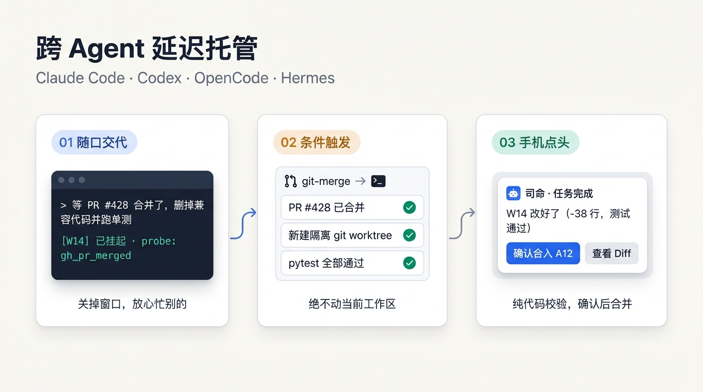
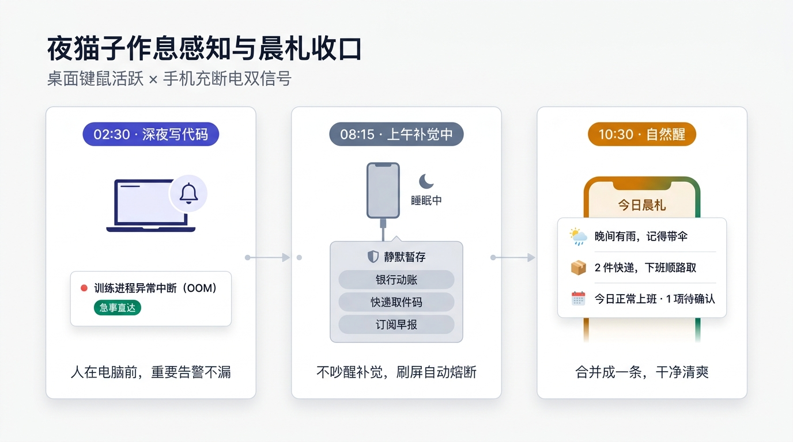
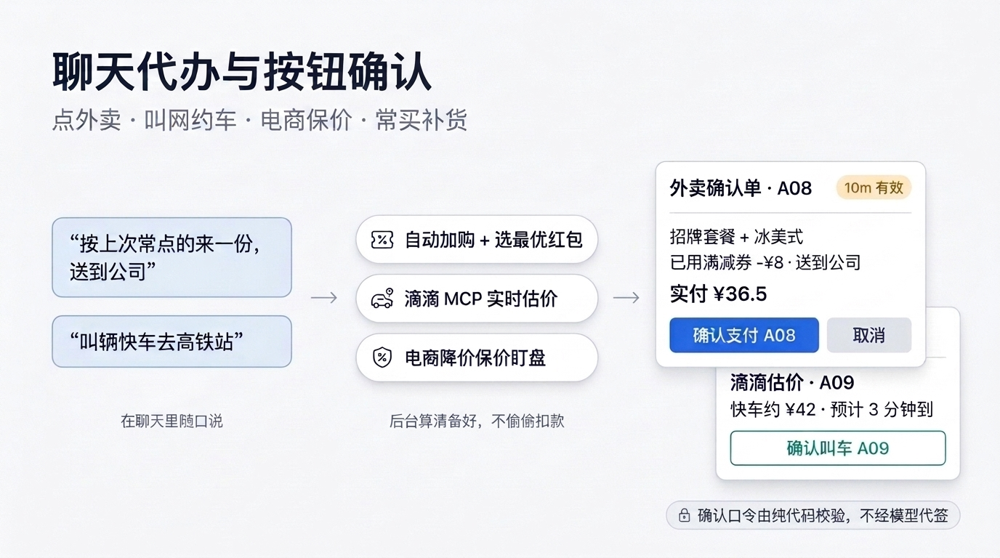
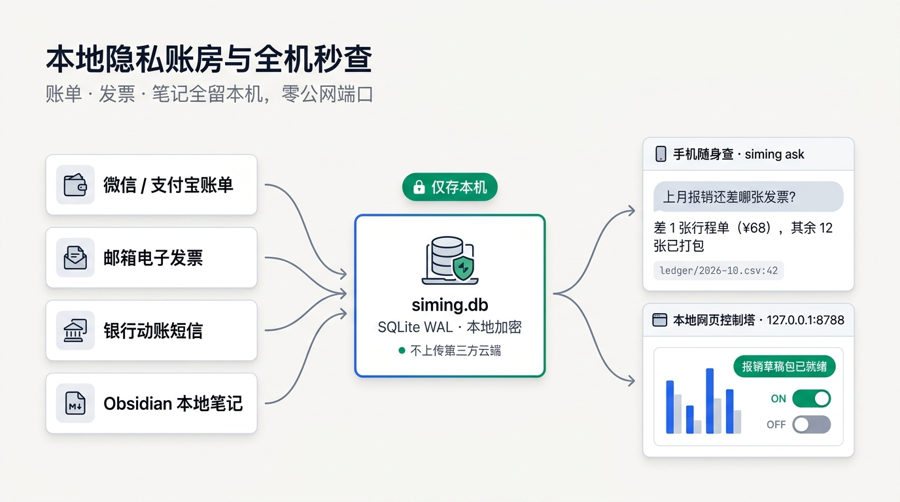

# 司命 (Siming)

一个跑在本机的个人助理后台，用 Python 3.12 和 SQLite 写就。

最初是为了解决我自己的两类麻烦：一边同时开着 Claude Code、Codex、OpenCode、Antigravity、Hermes 写代码，随口说一句「等这个 PR 合并了再删兼容代码」切走就忘；另一边每天有账单邮件、报销发票、快递取件码、法定调休、外卖打车和居家杂事，但又不想把银行流水和密钥交给云端托管。

司命把这些事收进本机一份 `siming.db`（SQLite WAL）。数据、账本和密钥都留在自己硬盘里，家用电脑不用开任何公网端口。

> 说明：这个项目是从我日常的 Linux 桌面 + iPhone + QQ 环境里长出来的，里面有 53 个可独立开关的功能模块（包括电车、Home Assistant、3D 打印、中国调休日历这类偏个人化的模块）。未接入硬件的模块默认静默，用不上的随时 `siming module off <模块名>` 关掉就行。

## 重点场景

### 1. 跨 Agent 延迟托管，条件到了自动在隔离分支改完

写代码时经常遇到当下不好动、但之后不能忘的事：等某个上游 PR 合并、等某次训练进程退出、等下周报销时顺手修个脚本。通过 `siming defer`（或在 Agent 对话里随口说，由 Skill 自动登记），司命在后台按条件盯着；条件满足后，按约定发提醒、在 `herdr` 后台标签页恢复原会话，或者在 `$TMPDIR` 的独立 `git worktree` 里改完代码并跑通测试，把 diff 发到聊天里等你确认合并。



```bash
# 等 PR #428 合并后，在隔离 worktree 里清理旧代码并跑通单测
siming defer add \
  --when "probe:gh_pr_merged:owner/repo#428" \
  --mode stage \
  --cwd ~/Work/my-app \
  --done-check "pytest -q" \
  --quote "删除旧版 feature flag 并跑通测试"

# 包装耗时命令，跑完或失败把退出码、耗时和末尾日志推给手机
siming run --name "全量回归测试" -- pixi run pytest -q
```

### 2. 夜猫子作息感知与晨札收口

固定时间点发早报对作息不规律的人很不友好：凌晨写代码时急事漏看，上午难得补个觉却被八点多的机器人消息吵醒。司命结合桌面键鼠活跃度与手机充断电/睡眠信号判断你当前是醒着还是睡着：深夜干活时严重告警直接发，补觉期间普通通知和银行动账静默压住，等你自然醒来合并成一条「今日晨札」。某条规则刷屏或连续两周没人理时，Push Guard 会自动限流并退回晨札。



```bash
siming today              # 终端预览今日晨札（调休、天气、快递、账单摘要、待办）
siming attention status   # 查看当前作息状态与静默队列
```

### 3. 聊天里代办日常琐事，算清后按钮一次确认

点常吃的外卖、叫网约车、盯已购商品降价保价、给常买消耗品补货，这些事不需要切好几个 App。在聊天里说一句，司命在后台把加购选券、滴滴 MCP 实时估价或比价算完，发回一张带原生按钮的确认卡，写清店名、明细、实付金额和送达地址。所有涉及改文件、发单或花钱的动作都走 `A2` 确认口令，由纯 Python 代码校验后才执行，不经模型代签，也不会在后台悄悄扣款。



```bash
siming price-watch add "https://item.jd.com/100012345678.html" --name "显示器" --paid 1999 --days 30
siming didi 高铁站          # 走滴滴 MCP 估价并生成待确认叫车卡
```

### 4. 本地隐私账房、报销拼包与全机带出处秒查

微信/支付宝导出的加密账单、邮箱里的电子发票、银行动账短信和 Obsidian 本地笔记，全在本机解析入库，不上传第三方云服务。在外面想查某个尺寸、某张卡几号出账、上月报销还差哪张票，用聊天或 `siming ask` 几秒内连同 `文件:行号` 一起答出来；需要细看图表、审阅共享知识库冲突或开关模块时，可以开一个只监听 `127.0.0.1:8788` 的本地网页控制塔。



```bash
siming ask "上月报销还差哪张发票？"                  # 联邦只读检索，附文件:行号出处
siming ledger import-zip ~/Downloads/wechat.zip      # 内存解密导入微信/支付宝账单
siming tower serve --host 127.0.0.1 --port 8788      # 启动本地网页控制塔
```

## 几条基本边界

- **本地优先，家用机零入站端口**：数据库、加密原件和 `0600` 凭据都在本机。如果启用 iPhone 快捷指令转发短信/定位/睡眠状态，只需一台极简公网 VPS 做 7 天加密暂存，本机定时通过 SSH 单向拉取。
- **确定性逻辑不交给模型赌概率**：事件采集、去重、推送熔断、权限审批和账务对账由纯代码负责，只在需要语义归并、总结或写代码时调用模型。
- **外部写操作由代码校验确认口令**：审批口令带过期时间，点一次确认即由纯代码校验消费，并记录「已授权 / 已提交 / 已核验」三态收据；后台改代码固定在独立 `git worktree` 中执行，未过 `--done-check` 不会提请合并。
- **临时盯梢带保质期**：每条 `defer` 挂起项和兜底扫描提议（默认只进 `PROPOSED` 待你确认，不会擅自激活）都有 TTL，过期自动归档，不攒僵尸定时任务。

<details>
<summary>展开查看系统架构图与权限闸门说明</summary>


完整进程边界、SQLite 表结构、六层事件链与按钮审批时序见 [docs/ARCHITECTURE.md](docs/ARCHITECTURE.md)。

</details>

## 快速上手（纯本机模式）

先跑通纯本机模式只需要几分钟，聊天机器人、systemd 常驻、公网 Edge、Sure 财务同步等都可以后面按 [docs/SETUP_GUIDE.md](docs/SETUP_GUIDE.md) 分阶段加。

### 1. 安装依赖

支持 [Pixi](https://pixi.sh/)（锁定 Python 3.12 及全部依赖）或 `uv`：

```bash
git clone https://github.com/kouyichi/siming.git ~/Work/siming
cd ~/Work/siming

pixi install
# 或者使用 uv:
# uv sync
```

### 2. 链接 `siming` 命令

```bash
mkdir -p ~/.local/bin
chmod +x ~/Work/siming/tools/siming-bin.sh
ln -sf ~/Work/siming/tools/siming-bin.sh ~/.local/bin/siming
```

确认 `~/.local/bin` 在 `PATH` 里，并建议把临时目录指向用户目录（司命默认禁止写 `/tmp`，避免临时账单落盘或撑爆内存盘）：

```bash
export TMPDIR="$HOME/.cache/agent-tmp"
```

### 3. 复制配置模板并初始化数据库

```bash
mkdir -p ~/.config/siming/secrets && chmod 700 ~/.config/siming/secrets
cp config.example/policy.example.yaml   ~/.config/siming/policy.yaml
cp config.example/sources.example.toml  ~/.config/siming/sources.toml
cp config.example/accounts.example.toml ~/.config/siming/accounts.toml

siming doctor
```

### 4. 试跑几条常用命令

```bash
siming today                                                     # 查看今日晨札
siming defer add --when "15m" --mode remind --quote "起身喝口水"   # 登记一条挂起提醒
siming defer list                                                # 查看当前挂起项
siming module ls                                                 # 查看全部 53 个模块状态
siming module off outing_amap_ev                                 # 关闭用不到的模块
siming module off movein_pm
siming tower serve --host 127.0.0.1 --port 8788                  # 启动本地网页控制塔
```

如果平时用 Claude Code / Codex / Hermes，把 [integrations/skill/SKILL.md](integrations/skill/SKILL.md) 复制到对应 Agent 的 skills 目录（如 `~/.agents/skills/siming/SKILL.md`），之后在对话里随口说「等 xxx 好了提醒我」就会自动调用 `siming defer` 落库。

## 模块总览

全部 53 个模块支持随时用 `siming module on/off <模块名>` 开关，清单和对应 CLI 见 [docs/MODULES.md](docs/MODULES.md)：

| 分组 | 包含的主要功能 |
| :--- | :--- |
| 跨 Agent 与研发 | `defer` 四档唤醒（`remind` / `resume` / `stage` / `run`）、长任务回执（`siming run` / `srr`）、`herdr` 卡住提醒、多 Runtime 路由、睡前 GPU 巡检、PR 与论文雷达 |
| 财务与消费 | 多邮箱账单/发票入库、微信/支付宝月度账单解密导入、多卡还款与报销游标、自托管 Sure OS 同步、美团/瑞幸/滴滴代办确认卡、网购保价与常买补货 |
| 知识库与记忆 | Hindsight 夜间共享 Wiki 与冲突裁决、M-SIM 跨模型经验记录、全机只读检索 `siming ask`、跨平台收藏入库与召回 |
| 日程、出行与生活 | iCloud/CalDAV 双向日历同步、Apple Health 观测、中国法定节假日与调休限行、快递取件码归集、周期用药与复诊提醒、电车续航与通勤决策 |
| 家居与 Homelab | Home Assistant 联动、新房送装与家电保修护照、Bambu 3D 打印状态与耗材、路由/NAS/TLS/AI 配额巡检、公网 Edge 失联告警 |
| 治理与控制塔 | Night-Owl 作息感知、Push Guard 推送限流、A1/A2/A3 权限审批、本地网页控制塔（`:8788`） |

## 目录约定

源码与个人数据严格分开，密钥目录禁止进入 Git：

```text
~/Work/siming/                 源码、SQL Schema、配置模板与文档（进 Git）
~/.config/siming/              个人规则配置（policy.yaml / accounts.toml / sources.toml）
~/.config/siming/secrets/      所有密钥与令牌（权限 0600，不进 Git）
~/.local/share/siming/         SQLite 状态库（siming.db）、加密原件 raw/、审计日志与备份
~/.cache/agent-tmp/siming/     隔离 git worktrees、账单临时解压、报销草稿包（不写 /tmp）
```

## 文档

- [docs/SETUP_GUIDE.md](docs/SETUP_GUIDE.md)：分 6 个阶段的配置手册（纯本机 → QQ/飞书 → systemd → 公网 Edge / iPhone → 账本与 Sure → 垂直插件）
- [docs/ARCHITECTURE.md](docs/ARCHITECTURE.md)：进程边界、六层事件链、按钮审批时序与数据库表说明
- [docs/MODULES.md](docs/MODULES.md)：53 个模块的说明、依赖数据源与对应命令
- [docs/IOS_SHORTCUTS_GUIDE.md](docs/IOS_SHORTCUTS_GUIDE.md)：iPhone 快捷指令（动账短信、睡醒充断电、截屏 OCR）配置方式
- [docs/DECISIONS.md](docs/DECISIONS.md)：关键架构取舍与安全红线记录
- [config.example/](config.example/)：配置文件模板
- [integrations/skill/SKILL.md](integrations/skill/SKILL.md)：供编码 Agent 加载的 Skill 文件

## 运行测试

仓库自带离线沙盒测试集，不发外部消息，也不读取你的真实个人目录：

```bash
SIMING_TEST_OFFLINE=1 SIMING_DISABLE_SSH_EDGE=1 pixi run pytest
```

## License

[MIT](LICENSE)
