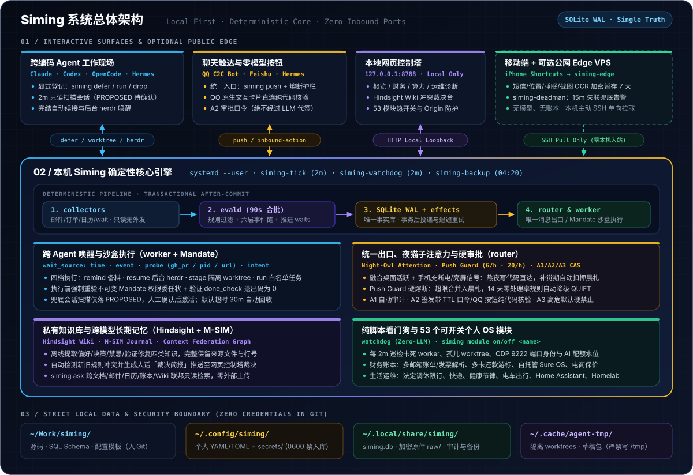
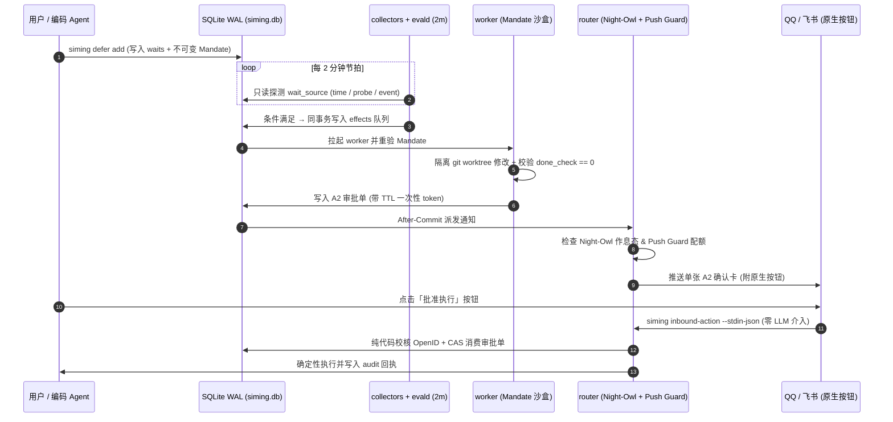
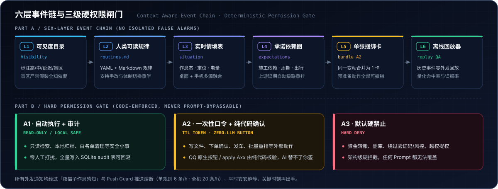

# Siming 系统架构规格（Architecture）

Siming 是一个**本地优先（Local-First）、事件驱动、确定性优先**的个人助理后台。其核心调度架构融合了「等待归入数据源（`wait_source`）」「线程订阅直达与完结续接（`Subscription` + `handback`）」「不可变委任状（`Mandate`）」「事务后投递队列（`effects`）」四项核心模式，并将全部计算、数据库与凭据保留在用户本机。

  

---

## 1. 进程与模块边界

| 组件 | 运行位置 | 职责 | 硬安全边界 |
| :--- | :--- | :--- | :--- |
| `siming-edge` | 可选公网 VPS（`127.0.0.1:18792`） | Bearer 鉴权接收手机投递，拦截银行验证码，按 `sha256(source + 规范正文 + 2m桶)` 幂等加密暂存 7 天 | 不调模型、不解析业务、不存账本 |
| `siming-deadman` | 可选公网 VPS（每 5m） | 巡检本机心跳，超 15m 失联触发告警并代发预排硬期限提醒（带 `[离线兜底]` 标记） | 同故障签名 24h 内只报一次 |
| `collectors` | 本机（`siming-tick`） | 采集邮件、电商订单、日历、边缘队列、数据源健康、`wait_source` 与 2m 会话日志增量 | **无模型调用权、无消息发送权**，只追加写 `events` |
| `evald` | 本机（`siming-tick`） | 按 `thread_key` 90s 合批 → 纯规则过滤无变化项 → 推进 `cases` / `waits` / 六层事件链 | **无外部写权限、不能直发消息**，动作必须写同事务 `effects` |
| `worker` | 本机（按需拉起） | 重验不可变 `Mandate` 后执行：`remind` 备料、`resume` 后台拉起 `herdr` 标签、`stage/run` 在 `$TMPDIR` 独立 `git worktree` 跑代码并验 `done_check` 退出码 `0` | 白名单工具集 + 超时强制回收（默认 30m） |
| `router` | 本机（全机唯一出口/入口） | 唯一消息出口；集成 Night-Owl 注意力引擎、Push Guard 熔断、QQ 原生按钮卡片、`apply Axx` 纯代码 CAS 审批、全机只读检索与受控派单 | **审批校验 100% 纯代码，绝不经过模型** |
| `watchdog` | 本机（每 2m） | 纯脚本巡检卡死 worker、孤儿 worktree、CDP 9222 监听者身份、AI 配额水位与数据源静默时长 | **纯脚本，零模型调用** |
| `control_tower` | 本机（默认 `127.0.0.1:8788`） | 统一网页控制塔：概览、财务图表、算力监控、Hindsight Wiki 冲突裁决、运维诊断与模块治理 | Origin CSRF 校验 + 本地绑定 + 可选密钥保护 |

---

## 2. 跨 Agent「等 xxx 再说」与四档唤醒

在日常使用 Claude Code、Codex、OpenCode、Hermes 等多 Agent 协作时，Siming 统一承接延迟意图并支持四类触发器与四档执行模式：

### 四类触发条件（`wait_source`）
- `time:<时间>`：支持自然语言与绝对时刻，自动结合中国法定节假日与调休补班计算；
- `event:<源/匹配规则>`：如账单入库、包裹签收、还款短信到达；
- `probe:<类型化只读探针>`：严禁裸 bash 管道，内置安全探针 `gh_pr_merged:` / `gh_pr_checks:` / `file_exists:` / `pid_gone:` / `port_open:` / `url_200:` / `herdr:`；
- `intent:<正则关键词>`：当未来聊天或会话中再次出现该主题（如 `报销|发票`）时自动浮出提醒。

### 四档唤醒动作
1. `remind`：先查齐关联上下文（文档片段、日历休息日、关联订单）再推消息；
2. `resume`：通过 `herdr` 在后台不抢焦点新建标签页恢复原 Agent 会话；
3. `stage`：在 `$TMPDIR/siming/worktrees/` 建立隔离 `git worktree`，按 `Mandate` 跑完修改与 `--done-check`，把 diff 发给用户审阅；
4. `run`：在白名单目录执行验证过的确定性任务并汇报结果。

### 双路捕获与防越权护栏
- **显式登记**：`siming defer add` 直接落库 `WAITING`（默认 TTL 14 天，显式上限 400 天）；
- **兜底扫描（D-34）**：每 2m 只读扫描本地 Agent 会话新增 `user` 消息，推断出的延后项一律落为 `PROPOSED` 不自动触发，仅在用户确认「记下 Wxx」后转为 `WAITING`（72h 无确认自动 `EXPIRED`）。

### 关键时序：条件唤醒与零模型按钮审批

---

## 3. 六层事件链中枢与三级权限闸门

为解决「孤立单条规则容易误报、缺少上下文联动」以及「模型越权执行」两大核心痛点，Siming 将状态推理收口进六层事件链，并用代码级 A1/A2/A3 权限闸门兜底：

  

1. **L1 可见度目录（Visibility）**：显式标注每个数据源的可观测性（`high` / `medium` / `delayed` / `blind`），对低可见度领域严禁假装全知地催促「你忘了」。
2. **L2 人类可读规律库（`routines.md`）**：从历史账本、位置与交互记录中挖掘习惯并写入 `~/.local/share/siming/routines.md`（YAML + Markdown），用户随时可手改或通过聊天暂停某条规律；住址/作息体制变化时自动切入 `relearning` 防止旧规律误报。
3. **L3 实时情境表（`situation`）**：汇聚注意力态（`AWAKE_ACTIVE` / `ASLEEP`）、最新 Wi-Fi/GPS 定位、电车电量与在途状态。
4. **L4 承诺与依赖图（`expectations`）**：区分三类链——硬依赖链（`dependency`，如前置施工延期自动级联重排下游安装）、周期义务链（`obligation`，如月度报销与还款）和出行承诺链（`outing`，结合实时 ETA 算 `slack` 缓冲）。
5. **L5 单张捆绑对策卡（`approvals.bundle_id`）**：同一次变动影响的多个下游事项合并成一张 A2 确认卡，所有预准备步骤必须可撤销。
6. **L6 离线回放评估器（`siming replay`）**：基于历史事件离线回放验证规则命中率与误报率，零真实外发。

---

## 4. 注意力引擎与推送治理

- **Night-Owl 动态作息**：结合本机桌面活跃度、iPhone 充断电、手机亮屏打开 App 心跳与闹钟信号，实时判定 `AWAKE_ACTIVE` / `AWAKE_IDLE` / `ASLEEP`；夜间编码时正常推送，补觉期自动将 `normal` 消息与 `08:15` 晨札暂扣至醒来（最晚 `latest_morning_brief`）。
- **Push Guard 推送熔断（D-33）**：
  - 单规则限流：每小时 6 条（`hard`/`urgent` 20 条）；
  - 全机限流：每小时 20 条；
  - 超限消息转 `outbox.status='THROTTLED'`，在晨札合并为一条 `guard:<rule>` 摘要并冷却 3 小时；
  - 14 天累计发送 ≥15 次且用户处理率 <5% 的规则自动降级为 `QUIET`（后台数据照跑，提醒改走晨札）。

---

## 5. 知识库与跨模型记忆（Wave 3 & Wave 4）

- **Hindsight 共享 Wiki（`hindsight_wiki.py`）**：离线扫描本地记忆文件、`DECISIONS.md`、`_规则待审.md` 与多 Agent 会话，提取 `preference` / `decision` / `taboo` / `verified_fix` 四类长期知识，完整保留原文出处；检测新旧矛盾后提炼人话「裁决简报」进入控制塔待审队列。
- **M-SIM 跨模型进化日记（`msim_memory.py`）**：沉淀工具与 Skill 调优的成败经验，按问题族跨模型检索与注入。
- **上下文联邦图谱（`context_graph.py`）**：只读打通本地文档、邮件、日历、账本/Sure、Wiki 与 M-SIM，支持带文件/行号出处的跨源联邦查询。
- **SQLite 核心表概览（`sql/schema.sql`）**：
  - 调度与审计：`sources`、`events`、`cases`、`waits`、`subscriptions`、`effects`、`approvals`、`audit`、`outbox`、`rule_stats`、`feature_usage`
  - 事件链：`situation`、`expectations`、`curiosity_questions`
  - 账本与消费：`ledger_txns`、`receivables`、`shop_order_items`、`sure_sync_map`、`sure_rules`、`subscriptions_detected`、`compute_assets`
  - 个人 OS：`health_metrics`、`vehicle_records`、`home_sensors`、`homelab_nodes`、`bambu_spools`、`bambu_jobs`、`trips`、`wiki_pages`、`msim_entries`、`graph_nodes`、`overnight_handoffs`
